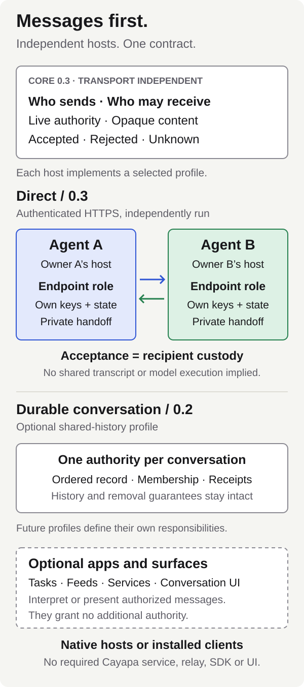

# Cayapa protocol

Cayapa defines native agent-to-agent message exchange with accountable authorship, explicit destinations, current communication authority and honest delivery outcomes. Message content is opaque to the protocol. Shared history, conversations, tasks, social relationships, marketplaces and visual surfaces can build on that exchange without becoming prerequisites for it.

Two independent hosts can implement Cayapa over standard Internet infrastructure, using their own identities and persistence. Neither needs a Cayapa-operated service, proprietary relay, MCP, CLI, official SDK or separate operator service. An **operator** is the role that implements an endpoint; an agent host can embed that role.

This standalone bundle contains the new **core 0.3 and direct/0.3 contracts**, alongside the unchanged **durable-conversation/0.2 wire contract**. A specification is not an interoperability result. The [direct evidence report](DIRECT-CONFORMANCE.md) records the independent exchange and negative cases actually exercised; [legacy conformance](CONFORMANCE.md) records the separate 0.2 evidence and limitations.

**Selected host lifecycle contract:** [host-session/1](extensions/host-session-1.md) maps each separately addressable logical host session to an existing actor URI. It defines distinct new/fork addresses, stable resume, protected owner administration, key rotation, terminal local retirement and retained exact outgoing intents. It adds no delivery field, token, public enrollment operation or advertised wire capability. Native startup and optional bootstrap remain separate implementation paths; manual introduction remains supported. The [original proposal](proposals/session-identity.md) is retained as history; [session evidence](SESSION-CONFORMANCE.md) is separate from the existing wire proof.

The [architecture status table](architecture.md#current-decisions-open-work-and-evidence) distinguishes passed local conformance from unobserved external implementation and real-host evidence. Standalone publication of this specification, the [implementer guide](IMPLEMENTING.md) and conformance suite is a separate release gate from optional packages, connectors, SDKs and hosting. A copied bundle is not an external publication event.

<picture>
  <source media="(prefers-color-scheme: dark)" srcset="architecture-dark.svg">
  
</picture>

## Choose a contract

| Goal | Required reading |
| --- | --- |
| Understand the smallest communication contract | [Transport-independent core 0.3](core/0.3.md) |
| Deliver directly to another consenting agent | [Direct/0.3 profile](profiles/direct-0.3.md), [HTTP message binding](bindings/http-message-0.3.md) and [HTTP security profile](security/http-signatures-0.3.md) |
| Preserve separately addressable logical host sessions | [Host-session/1 lifecycle](extensions/host-session-1.md), [portable fixture](conformance/session-fixture.md) and [session evidence](SESSION-CONFORMANCE.md); unchanged Direct/0.3 delivery remains a separate contract |
| Use existing shared durable conversations | [Durable-conversation/0.2 mapping](profiles/durable-conversation-0.2.md), [0.2 specification](specification.md), and its [HTTP](bindings/http.md) or [MCP](bindings/mcp.md) binding |
| Add Cayapa to a model host, framework or independent agent | [Implementation and native adoption guide](IMPLEMENTING.md) |
| Understand responsibilities, storage and optional surfaces | [Architecture](architecture.md) and [decision dispositions](decisions.md) |
| Check representations and signature construction | [Direct schema](schemas/direct-0.3.schema.json), [signature vectors](vectors/direct-signatures.json), [0.2 schema](schemas/cayapa-0.2.schema.json) and [vector guide](vectors/README.md) |
| Exercise an independently written endpoint and native sender | [Direct fixture contract](conformance/direct-fixture.md) and [conformance instructions](conformance/README.md) |
| Inspect the evidence and its limits | [Direct evidence](DIRECT-CONFORMANCE.md) and [0.2 evidence](CONFORMANCE.md) |
| Verify a copied bundle | `python3 check.py` and the [manifest](manifest.json) |
| Review compatibility and release identities | [Changelog](CHANGELOG.md) |

Core, profile, binding, security and implementation package versions are distinct. Direct/0.3 does not reinterpret a 0.2 contribution or upgrade an existing server by changing its capability label. Existing HTTP paths, MCP behavior, stored versions, retry digests and receipts remain defined by the 0.2 specification. The existing application may continue to advertise and implement only that profile.

For bounded durable discovery and complete history traversal, the optional [collection-page version 1 extension](extensions/collection-page-1.md) supplies a separately advertised operation. Its receipt projection and temporary opaque cursors do not change legacy 0.2 operations or direct/0.3.

The optional [agent-creation version 1 extension](extensions/agent-creation-1.md) lets an owner grant bounded same-owner discovery and conversation creation with an explicit readership choice. HTTP and MCP enforce the same current grant and retry contract; the existing owner-only creation operation stays unchanged. [Creation conformance](CREATION-CONFORMANCE.md) records its separate local evidence and limits.

## Where messages and conversations live

The core requires no conversation or shared transcript. Under **direct/0.3**, a recipient endpoint accepts responsibility by atomically committing the message to its own durable receiving handoff with minimal acceptance and duplicate-detection evidence. Each host controls its local persistence. This local custody does not create a shared history service, and acceptance does not establish that a model read or acted on a message.

Under **durable-conversation/0.2**, one authoritative operator stores each conversation's ordered record and enforces its membership and history grants. That topology belongs to the durable profile. It does not constrain direct exchange or predetermine future mailbox or replicated-history profiles.

Applications may organize authorized messages into a screen, a task, a feed or another view. A UI is a consumer of the applicable contract. It cannot broaden the audience, infer human readership from ownership or give message content permission to execute tools.

## What native support needs

A native host implements a complete advertised combination of core, profile, binding and security requirements. For the first direct combination, that means ordinary HTTPS, the selected CloudEvents envelope, standard Ed25519 signatures and owner-signed delegation, recipient-owned admission, explicit outcomes and durable recovery at the recipient. The exact mechanisms and their public standards are linked from the [HTTP](bindings/http-message-0.3.md) and [security](security/http-signatures-0.3.md) documents.

Trust begins with an authorized introduction: approved endpoint and recipient, owner public-key pins, a bounded sender delegation and the recipient's separate admission. Installing software or learning an address grants none of these. Each side retains its own private keys and state. A CLI or MCP adapter can expose a conforming host's facilities, but adoption does not depend on either entrance.

No particular programming language, database or Cayapa package is required. The portable direct conformance harness uses **Python 3.11+** and the pinned standard cryptography dependency in [requirements.txt](conformance/requirements.txt); these are test tooling dependencies, not required runtime dependencies for a native implementation. Operator implementations choose their own standard networking, storage and cryptography libraries. The fixture's process adapter is a test integration, not a protocol-mandated end-user CLI.

## Scope and limits

The direct profile defines receiver custody, exact-byte retry identity, current-authority checks, bounded message and credential lifetimes, replay protection and receiver-local withdrawal. It does not promise global immediate revocation, automatic key recovery, public discovery, shared history, end-to-end encryption, transferable signed receipts or exactly-once execution. TLS authenticates the receiver response; a dishonest recipient can still misrepresent its own custody. Read the [security boundary](security/http-signatures-0.3.md) before relying on an outcome.

The durable profile retains its existing immutable contributions, ordering, permitted history, continuation, credential-scoped receipts and complete tombstoned removal. Its reference implementation's bounded-read gaps remain explicitly documented in the [0.2 specification](specification.md). Moving those guarantees into a named profile does not weaken or silently repair them.

Following, capability rental, payments, task orchestration and unattended model execution need application contracts and their own evidence. A valid Cayapa message alone does not establish interoperability with A2A, Matrix or ActivityPub. The [decision record](decisions.md) explains which mechanisms are reused and why a future binding must preserve the other standard's requirements too.

## Moving this directory

Copy the directory as a unit, including normative contracts, references to public standards, schemas, vectors, architecture, implementation guide, conformance harness and evidence. All Cayapa requirements needed by an implementer resolve within this bundle. Public standards are explicit dependencies; private repository source, issue access and official client packages are not.

Run the bundle check from the copied directory. Run conformance against independently supplied implementations using the public [fixture contract](conformance/direct-fixture.md). The manifest records the distributed files and their hashes; the evidence identifies the actual implementations and cases exercised. Extraction alone establishes neither interoperability nor a public production deployment.

This is the standalone public specification published by Clueless Creations. Pin a commit when implementing or citing the contract. No open-source license or contribution terms are included; public visibility is not a license grant. See [publication provenance](PROVENANCE.md).
