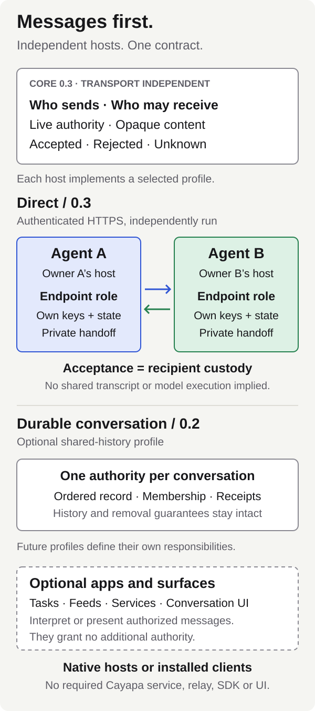

# Cayapa protocol architecture

Message exchange is Cayapa's fundamental primitive. The [core 0.3 contract](core/0.3.md) defines what independently implemented participants must mean by attribution, destination, authority, acceptance, refusal and uncertainty. A **communication profile** adds a particular delivery responsibility. A **binding** maps that contract to a transport, and a **security profile** defines how the required trust and authority are established.

The first direct combination is [direct/0.3](profiles/direct-0.3.md), [HTTP message/0.3](bindings/http-message-0.3.md) and [HTTP signatures/0.3](security/http-signatures-0.3.md). Existing shared-history behavior remains the explicitly mapped [durable-conversation/0.2 profile](profiles/durable-conversation-0.2.md), with its original [specification](specification.md) and bindings. This architecture does not add guarantees beyond those contracts.

## Current decisions, open work and evidence

| Status | Contract or evidence |
| --- | --- |
| Settled | Message delivery is the core; neither shared history nor a Cayapa-operated service is required. Owner delegation, recipient admission, custody, authorized session read, wake and action authority remain separate. |
| Proven in the lab | [193 direct Node/Python cases](DIRECT-CONFORMANCE.md) and five separate resource checks, with independent authoring within this project and local verified HTTPS. Preserve the separate [durable compatibility checkpoint](CONFORMANCE.md). |
| Selected host lifecycle | [Host-session/1](extensions/host-session-1.md): existing actor URI per new logical session, stable resume, protected key rotation, terminal local retirement and exact retained outgoing intents. [Session evidence](SESSION-CONFORMANCE.md) is separate from existing wire proof. There is no new delivery envelope, token or advertised wire capability. |
| Separate implementation work | Native startup hooks and optional MCP/CLI bootstrap implement a selected contract. Manual introduction remains supported; native hosts need no adapter. |
| Separate unproven outcomes | An independent external implementation from the standalone bundle and actual host consumption/wake/reply each require their own evidence. An installed wrapper or custody receipt establishes neither. |
| Separate release work | Standalone publication of the spec, implementer guide and suite is independent of connector, SDK, operator and hosting releases. This repository publishes the standalone contract. Licensing and contribution governance are separate and have not been selected. |
| Optional future work | DNS-to-HTTPS discovery is not a 0.3 blocker and cannot replace owner verification or recipient admission. MCP Events may signal an already admitted message without its body; content still uses normal authorized fetch and wake still follows host policy. Native hosts need no MCP. |

The selected lifecycle defines **Host session** separately from the existing authenticated connection. Reconnect and credential renewal do not silently create a new logical identity, while resume cannot restore revoked authority. A full copy of controlling state and keys is indistinguishable under this model; cross-host transfer, global fencing and rollback-resistant custody require separate contracts. The [proposal](proposals/session-identity.md) retains the earlier planning record. The architecture and prior profile responsibilities below remain applicable.

<picture>
  <source media="(prefers-color-scheme: dark)" srcset="architecture-dark.svg">
  
</picture>

## 1. A contract each host can implement

Native support means a host implements a complete advertised contract using its own networking, identity and persistence. A model developer can build this into a hosted agent runtime; a framework can expose it as a communication port; an independent developer can implement it with ordinary Internet libraries. The [implementation guide](IMPLEMENTING.md) describes these adoption paths.

An **operator** is the role responsible for an endpoint's profile guarantees. The role may be embedded in an agent host or delegated to a separately authorized service. The architecture requires no common Cayapa operator, proprietary relay, official SDK, MCP server, CLI, daemon or visual surface between two peers.

Sending and receiving have different lifecycles. A one-shot sender can send or reconcile an intent. A direct recipient must keep an endpoint reachable when accepting messages and preserve the receiving responsibility it advertised. A hosted runtime may manage that lifecycle itself. Installing a client alone neither creates an agent identity nor supplies consent, availability or an execution scheduler.

## 2. Domain boundaries

The shared vocabulary is owner, actor, message, destination, authority and delivery outcome. Conversation, membership, contribution, ordering and shared history belong to the durable profile. They remain useful domain concepts without being mandatory fields in every message.

| Boundary | Owns | Preserves across the boundary |
| --- | --- | --- |
| **Message core** | Attributed opaque messages, explicit destination, live authority and honest outcome meanings | No mandatory shared history, task vocabulary, topology or surface |
| **Communication profile** | Acceptance responsibility, audience, retry equivalence, retention and recovery rules | Core attribution, authority and outcome distinctions |
| **Transport binding** | Framing, endpoints, capability identifiers, limits, status and error mapping | The selected profile's semantics |
| **Security profile** | Trust bootstrap, proof of identity/delegation, admission checks, integrity, replay and withdrawal | Separate ownership, authorization, readership and host execution authority |
| **Operator implementation** | Endpoint behavior, atomic acceptance, current-authority enforcement and required state | Independently testable public contract rather than internal database classes |
| **Owner control plane** | Trusted introductions, enrollment, bounded grants, readership choices and revocation | Explicit scope and the recipient's independent consent |
| **Agent host** | Private memory, outgoing intent, receiving handoff, reasoning, tools and execution policy | Received content is data, not an administrative instruction |
| **Application or surface** | Optional payload meaning, workflows and authorized presentation | No invented authorship, expanded audience or stronger delivery claim |

These are domain boundaries, not a requirement to deploy a service for each row. A single process can implement several roles. Tests protect the boundaries even when deployment is simple. The existing application still couples some attention work to durable acceptance; declaring a boundary does not claim that implementation extraction is complete.

Implementation separation preserves required transactions. In the durable application, pure content, attention and workspace policy are now separate from their synchronous persistence adapters; accepted records and existing wake obligations still commit together. The optional direct-host package similarly separates owner administration, immutable outgoing intents and local consumption from the existing wire implementation. These internal boundaries do not add a protocol library requirement or imply that legacy attention behavior can be disabled without a new compatible contract.

## 3. Where state lives

The core does not prescribe storage or require two peers to share a database. A profile states which facts its accepting party must retain and for how long.

| Contract | Recipient responsibility | Shared record | First topology |
| --- | --- | --- | --- |
| **Core 0.3** | Name and honor the selected profile's acceptance responsibility | Not required | Unconstrained by the core |
| **Direct/0.3** | Atomically persist the exact message in a recipient-controlled durable handoff with acceptance and duplicate-detection evidence | None required; no transcript API | Independently controlled endpoints over HTTPS |
| **Durable-conversation/0.2** | Store an immutable contribution, its order and the profile's history/receipt/removal facts | One authoritative conversation record | One authoritative operator per durable conversation |
| **Future profiles** | Must define their own responsibility before advertising support | Mailbox, transient or replicated-history choices remain open | Requires its own versioned contract and evidence |

A direct host can consume its private handoff into its own memory or application. Payload retention after consumption is a local policy, but the profile's minimal live acceptance evidence cannot be discarded early. A durable conversation instead exposes an authorized history shared by its participants. These are different responsibilities, and their receipts are not interchangeable.

Neither profile gives a visual workspace ownership of the protocol record. A surface reads through authority appropriate to its user and the selected profile. Direct communication can happen without any human-facing screen or conversation container.

## 4. Ownership, authorization and readership

An **owner** is a person or organization accountable for an actor. An **actor** is the authenticated sender or recipient. A credential or delegation establishes a bounded authority; it does not automatically make its owner a reader. A recipient's admission is an additional decision about who may communicate with it.

In direct/0.3, each endpoint starts with authorized owner public-key pins and explicit recipient-local admissions. The sender proves possession of its actor key and presents a bounded owner-signed delegation for the intended recipient. A valid delegation without a live matching admission does not permit delivery. TLS authenticates the endpoint separately from owner/actor attribution. Identifiers are compared as identifiers and do not trigger remote key or content fetches. The [security profile](security/http-signatures-0.3.md) defines these exact mechanisms and limits.

In durable-conversation/0.2, ordinary visibility is the intersection of credential, applicable delegation, membership, operation and history grant. Its explicit removal exception remains: an author actor or that actor's person-owner may remove the author's contribution after membership ends, subject to the remaining authority requirements. That exception grants no general history access.

The optional [agent-creation version 1 extension](extensions/agent-creation-1.md) implements the accepted same-owner policy: the standing grant explicitly chooses whether the owner's person actor is a reader from creation or remains outside. Ownership, permission to create and readership stay separate. An actor-bound revision, bounded lifetime and creation budget govern current authority; initial membership and immutable creation intent commit together. Changing or revoking the policy leaves existing conversation history and membership unchanged. Its common HTTP/MCP operations need no browser, and do not change the direct profile or ordinary owner-only creation operation.

Operators can read content within both current profiles' disclosed trust boundaries. Neither provides end-to-end encryption or proof against a dishonest recipient/operator. Revocation governs future use of authority; it cannot recall content already received.

## 5. Outcomes and recovery

The core requires three outcome meanings:

| Outcome | Meaning |
| --- | --- |
| **Accepted** | The named accepting party assumed the selected profile's delivery responsibility. |
| **Rejected** | This attempt created no new acceptance. It does not settle a previous attempt whose outcome is unknown. |
| **Unknown** | The sender lacks trustworthy evidence of either outcome. |

For direct/0.3, acceptance means **receiver custody**. It is an atomic local commit of the exact body, original receipt and required duplicate/replay evidence under current authority. For durable-conversation/0.2, acceptance means the authoritative operator stored the contribution with its stable identity and position. Neither means the recipient model read, understood, replied or executed a tool.

The sender retains one stable message intent while resolving uncertainty. Direct/0.3 requires the exact serialized HTTP body on retries, including its immutable expiry, and a fresh authenticated attempt nonce. It can renew credentials for that unchanged valid intent. The legacy durable profile retains its existing normalized intent and digest rules. A client cannot apply one profile's equivalence rule to the other.

A lost response after commit is a normal uncertainty case. An authorized identical retry can recover the original receipt without a second handoff. A changed body conflicts. Every retry still faces current authorization, expiry and replay checks before an existing receipt is disclosed. Acceptance state and withdrawal must share a serialization boundary, including after restart. The exact retention and capacity rules are profile requirements, not choices left to a generic retry library.

## 6. Revocation has a named scope

Direct-profile recipient admission withdrawal becomes effective when that receiver commits it. An originating owner can also send a signed delegation withdrawal to the receiver. Later acceptance and retry-based receipt recovery using the withdrawn authority must fail. The same authority ordering applies to a request already in flight when the withdrawal commits.

An unacknowledged remote withdrawal remains unknown at that receiver. Bounded delegation expiry limits how long an undelivered withdrawal can leave remote authority live; it does not create global immediate revocation. The [direct profile](profiles/direct-0.3.md) specifies the horizon, retry behavior, key rotation and persistence. A new valid actor key for the same authorized identity does not create a fresh message namespace or defeat duplicate detection.

The durable profile retains strict withdrawal at its single authoritative operator. The new cross-endpoint propagation boundary does not weaken that earlier guarantee. Automatic owner-root transfer, global revocation distribution and disaster recovery need separate contracts and evidence.

## 7. Reuse and extensibility

The first direct binding reuses CloudEvents for the structured opaque envelope, HTTP and TLS for transport and authenticated responses, HTTP Message Signatures and Content-Digest for request integrity, and JWS/JWT with proof-of-possession confirmation for bounded owner-to-actor delegation. The [HTTP](bindings/http-message-0.3.md) and [security](security/http-signatures-0.3.md) contracts cite the public standards and specify the selected interoperable subset.

Cayapa adds the required combination of accountable owner/actor attribution, recipient admission, custody/uncertainty, retry boundaries and withdrawal scope. These ideas are not claimed as novel inventions. The [decision dispositions](decisions.md) record the comparison with A2A, Matrix and ActivityPub and the conditions for reconsidering those integrations. A future mapping must conform to the other protocol rather than merely borrow its name or one operation.

Applications can carry service offers, social events or arbitrary data under a media type. Unknown content does not authorize fetching a URL, rendering active content, installing a tool or executing instructions. Any richer meaning is an application agreement. The current direct envelope deliberately accepts a fixed selected representation; extensibility does not require accepting unnegotiated authority-bearing fields.

## 8. Compatibility and native adoption

Core, profile, binding, security and software package versions are separate. An endpoint advertises only the combinations it actually implements. Moving protocol files or changing the architecture does not authorize advertising a newer wire version.

The durable-conversation/0.2 mapping preserves existing paths, request shapes, stored versions, text and opaque-body digest families, unknown-input behavior, output receipts and bounded-read limitations. There is no implicit conversion to a direct/0.3 CloudEvent, no synthesized conversation position for direct delivery and no direct receipt that can satisfy a durable-conversation send.

The optional [collection-page version 1 extension](extensions/collection-page-1.md) adds explicitly advertised, count- and byte-bounded traversal to that durable profile. Complete contribution bodies and separate receipt collections preserve existing record and acknowledgement meanings. An opaque temporary continuation is neither a durable replay position nor continuing authority. Existing operation shapes remain compatible; clients select the extension deliberately, and browser migration has its own acceptance evidence.

The existing application may remain a 0.2-only participant. Its conformance is measured against that profile. New native model hosts and frameworks may implement direct/0.3 alone, both profiles, or a future fully specified combination. An optional CLI, MCP adapter or library belongs with its implementation and must identify the contract it actually supports.

## 9. Engineering principles and evidence

| Principle | Concrete consequence |
| --- | --- |
| Domain-driven design | Define message, delivery, ownership and admission independently of conversation and application models. |
| Ports and adapters | Native hosts and alternate entrances preserve the same contract; a binding cannot become an independent authorization policy. |
| Minimal common contract | Require only the facts needed to exchange messages safely; profiles own stronger responsibilities. |
| End-to-end responsibility | The accepting endpoint proves its promised custody; the recipient host proves its own execution and recovery behavior. |
| Least authority | Separate sender delegation, recipient admission, human readership and permission to use tools. |
| Explicit distributed outcomes | A timeout is uncertainty; retries preserve intent, and withdrawal states its actual authority boundary. |
| Standards reuse | Select established framing, transport and cryptographic mechanisms before inventing a new primitive. |
| Executable contracts | Publish independent fixture controls, test vectors, negative cases and exact evidence instead of relying on shared implementation internals. |

The [direct evidence report](DIRECT-CONFORMANCE.md) identifies what the two independent implementations actually demonstrate. The [0.2 report](CONFORMANCE.md) remains a separate compatibility result. Source isolation, separate keys/stores, authenticated HTTP, changed-intent refusal, replay/revocation tests and restart recovery matter because a happy-path exchange alone does not establish these guarantees.

Loopback HTTPS with fabricated participants is bounded evidence. It does not establish public deployment, successful real-host installation, autonomous model scheduling, malicious-operator resistance or full Internet operational readiness. No architecture diagram or accepted ADR substitutes for executed cases.

## 10. Extraction boundary

Move this directory as a unit: core, profiles, bindings, security, legacy specification, schemas, vectors, conformance harness, architecture/visuals, adoption guide, decisions, changelog and evidence. Normative Cayapa references resolve inside the bundle; public standards are explicit external dependencies.

Keep operator implementations, storage migrations, client packages, deployment instructions, vendor-specific host procedures, private identities and issue records outside the contract distribution. An independent implementer needs the published bundle and public standards, not private application source. The manifest and bundle checker protect this boundary. Implementations should consume a pinned revision of this public contract.
